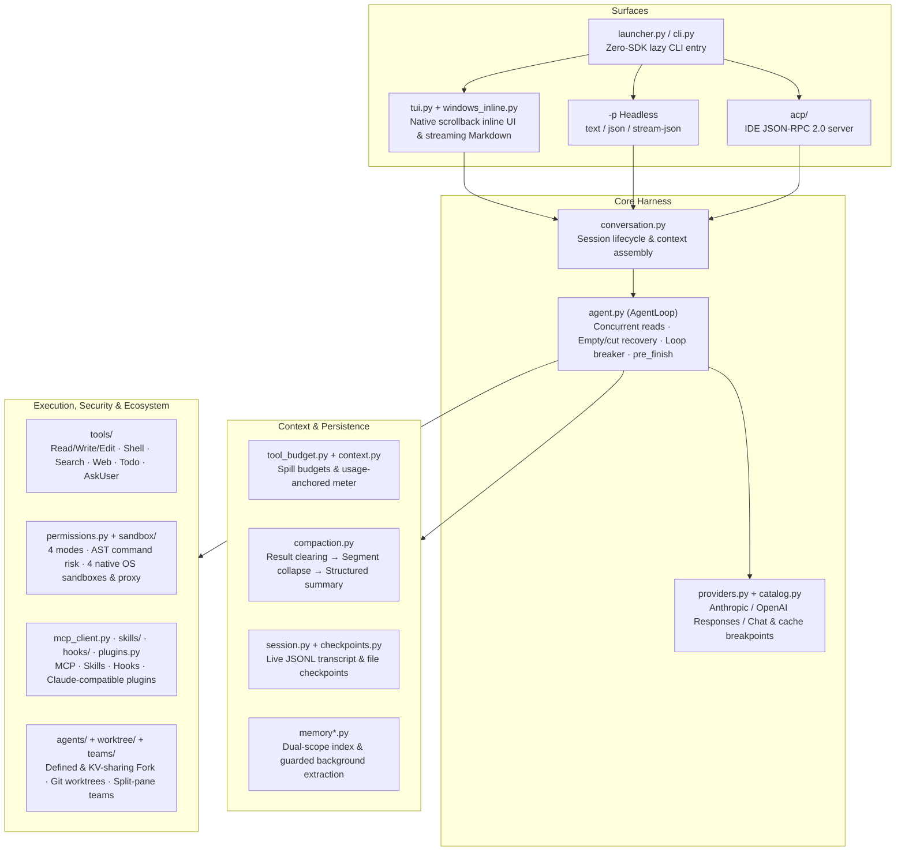
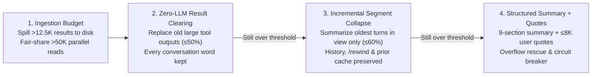

<p align="center">
  
</p>

<h1 align="center">MossCode</h1>

<p align="center">
  <b>A Production-Grade Coding Agent Harness for Terminals & ACP-Compatible IDEs</b><br />
  <sub>Self-Healing ReAct Loop · 4-Stage Cache-Preserving Context Compaction · 4 Native OS Sandboxes · Multi-Agent Worktree Teams · ACP IDE Server</sub>
</p>

<p align="center">
  <a href="https://github.com/yzd05/mosscode/actions/workflows/ci.yml"></a>
  
  
  
  <a href="LICENSE"></a>
</p>

<p align="center">
  <a href="README.md">中文</a> · <b>English</b> · <a href="docs/usage.en.md">Usage Guide</a> · <a href="docs/claude-code-patterns.md">Architecture Trade-offs (ZH)</a> · <a href="docs/reference/evaluations.md">Benchmarks (ZH)</a> · <a href="docs/reference/acp.md">IDE Integration / ACP (ZH)</a> · <a href="ROADMAP.md">Roadmap</a> · <a href="CHANGELOG.md">Changelog</a>
</p>

---

**MossCode** is a Python-built coding agent runtime designed after **Claude Code** and **pi**. A single shared `Conversation` harness powers three surfaces simultaneously: an **inline terminal UI** (preserving native terminal scrollback and text selection), a **scriptable headless CLI (`-p`)**, and a standard **Agent Client Protocol (`moss acp`) server** for JetBrains IDEs, Zed, and other editors. Vendor-neutral across major model protocols and backed by OS-level command sandboxes, it is engineered for long-horizon software engineering tasks.

### Core Engineering Highlights

<table>
  <tr>
    <td width="50%" valign="top">
      <b>⚡ Self-Healing Agent Loop</b><br />
      Up to 4 concurrent read-only tool calls per batch; automatic retry on empty or thinking-cutoff replies; seamless auto-continuation on output truncation; repetition detection &amp; circuit breaking; autonomous <code>/goal</code> loop and deterministic <code>pre_finish</code> verification hooks.
    </td>
    <td width="50%" valign="top">
      <b>🧠 4-Stage Cache-Preserving Context Pipeline</b><br />
      Disk spill budgeting → zero-LLM old tool-result clearing → non-destructive prefix segment collapsing (preserving <code>/rewind</code> &amp; earlier cache hits) → 9-part structured summary + <code>8,000</code>-token verbatim user quote retention; append-only state reminders keep KV-cache prefixes intact.
    </td>
  </tr>
  <tr>
    <td width="50%" valign="top">
      <b>🛡️ 4 Permission Modes &amp; 4 Native OS Sandboxes</b><br />
      <code>default</code>, <code>acceptEdits</code>, read-only <code>plan</code>, and <code>bypassPermissions</code> with <code>tree-sitter-bash</code> subcommand risk analysis; native confinement via Linux <code>bubblewrap+seccomp</code>, macOS <code>Seatbelt</code>, and Windows <code>MXC</code> / restricted tokens, paired with a loopback domain proxy and secret scrubbing.
    </td>
    <td width="50%" valign="top">
      <b>🔌 3 Model Protocols &amp; Zero-Duplicate Setup</b><br />
      First-class streaming, prompt caching, reasoning effort, vision input, and bundled LiteLLM pricing across <code>Anthropic Messages</code>, <code>OpenAI Responses</code>, and <code>Chat Completions</code>; one-step <code>follow</code> reuses existing local Claude Code or Codex credentials.
    </td>
  </tr>
  <tr>
    <td width="50%" valign="top">
      <b>🧩 Native IDE Integration (ACP 1.0)</b><br />
      <code>moss acp</code> serves stdio JSON-RPC 2.0 out of the box for <b>JetBrains IDEs (PyCharm, IntelliJ IDEA)</b> and <b>Zed</b>, featuring isolated multi-workspace sessions, structured file diffs, live mode/model selectors, and native permission approval cards.
    </td>
    <td width="50%" valign="top">
      <b>🤝 Multi-Agent &amp; Split-Pane Worktree Teams</b><br />
      Defined sub-agents, <b>KV-cache-sharing <code>Agent Fork</code></b>, isolated Git worktrees, and parallel agent teams running in <b>Windows Terminal or tmux</b> split panes with dependency-aware topological branch merging.
    </td>
  </tr>
  <tr>
    <td width="50%" valign="top">
      <b>⏪ Message-Level Time Travel &amp; Dual-Scope Memory</b><br />
      Crash-safe JSONL session streaming; <code>/rewind</code> rolls both workspace files and conversation state back to any prior message; hierarchical <code>AGENTS.md</code> loading plus background memory extraction with guardrails against blind overwrites.
    </td>
    <td width="50%" valign="top">
      <b>🔧 Claude Code-Compatible Ecosystem</b><br />
      Non-blocking background <code>MCP</code> discovery (stdio &amp; HTTP), Agent <code>Skills</code> (<code>SKILL.md</code> + custom script tools), 4 lifecycle <code>Hooks</code>, and user/project plugins compatible with <code>.claude-plugin</code> marketplaces.
    </td>
  </tr>
</table>

### Public Benchmark Snapshot (Terminal-Bench 2.1)

Head-to-head evaluation on the locked **Harbor 0.26.0 · Terminal-Bench 2.1** 12-task development baseline under identical `deepseek-flash` endpoints, official container limits, single concurrency, and zero human intervention:

| Agent | Runtime Setup | End-to-End Pass Rate (12 Tasks) | Diagnostic Rate (Excl. Pre-Model Container Faults) | Unified Off-Peak Est. Cost |
| :--- | :--- | :---: | :---: | :---: |
| **MossCode** | Locked Harbor wheel adapter | **9 / 12 (75.0%)** | **9 / 10 (90.0%)** | **~\$0.24** (lower bound) |
| **Terminus 2** | Harbor 0.26.0 built-in `2.0.0` | 7 / 12 (58.3%) | 7 / 11 (63.6%) | \$0.45 |

> [!NOTE]
> Results reflect a single-pass, fixed-seed 12-task development baseline (not the full 89-task leaderboard); 3 zero-token infrastructure faults (2 Debian APT 502 errors, 1 `tmux` startup failure) are retained in the end-to-end denominator. Full reproduction commands, lockfiles, and caveats are documented in [evaluations.md](docs/reference/evaluations.md).

## Install

Requires **Python 3.12+**. Install as an isolated global CLI with [uv](https://docs.astral.sh/uv/):

```bash
# Install the latest main branch directly from GitHub (works immediately)
uv tool install git+https://github.com/yzd05/mosscode.git

# Or install a tagged release from PyPI
uv tool install mosscode

# Verify installation, PATH, credentials, sandbox backends, and helper tools (offline)
moss doctor
```

This installs both `moss` and `mosscode`. Platform notes, upgrading/uninstalling, container usage, and OS sandbox setup: [installation details](docs/usage.en.md#installation-details). Source installation: [contributing](CONTRIBUTING.md).

## Configure

Running `moss` for the first time launches an interactive setup wizard (`moss setup` re-runs it anytime):

| Onboarding Path | Best For | Experience |
| :--- | :--- | :--- |
| **Follow (`follow`)** | Existing local Claude Code or Codex setups (incl. CC Switch / Magpie) | Zero duplicate entry—reuses endpoint, model, and key; `/model` re-syncs live |
| **Vendor Presets (`preset`)** | DeepSeek, Kimi, GLM, Qwen, OpenRouter, Anthropic, OpenAI | Pre-fills protocol, base URL, default model, and env var name automatically |
| **System Keyring** | Windows Credential Manager / macOS Keychain / Linux Secret Service | `moss key set <name>` stores keys encrypted; `config.yaml` never holds plaintext secrets |

Minimal `~/.mosscode/config.yaml` when editing by hand (all fields in [config.example.yaml](config.example.yaml)):

```yaml
providers:
  - name: deepseek
    preset: deepseek                  # or explicit protocol: anthropic-messages / openai-responses / openai-chat-completions
    model: deepseek-chat
    api_key_env: DEEPSEEK_API_KEY     # env var name; or api_key_keyring for system keyring entries
```

Project-level trust gates, permission rules, MCP, skills, hooks, sub-agents, and plugins: [usage guide](docs/usage.en.md#configuration).

## Use

### Five Entry Modes

```bash
moss                                        # start the inline terminal UI (native scrollback preserved)
moss "explain this repository's architecture" # launch the TUI and send the prompt immediately
moss -c                                     # resume the latest session in this workspace
moss -p "run tests and summarize failures"  # headless mode (supports text / json / stream-json)
moss acp                                    # start the ACP server (stdio JSON-RPC 2.0 for IDEs)
```

<details>
<summary><b>✨ Connect MossCode in PyCharm / IntelliJ IDEA / Zed via ACP (Click to expand)</b></summary>

<br />

Point JetBrains AI Chat (`~/.jetbrains/acp.json`) or Zed (`settings.json`) to `moss acp` to run MossCode natively inside your IDE sidebar (details in [acp.md](docs/reference/acp.md)):

```json
{
  "agent_servers": {
    "MossCode": {
      "command": "moss",
      "args": ["acp"]
    }
  }
}
```

</details>

### Interactive Commands & Shortcuts

| Category | Commands & Keys | Purpose |
| :--- | :--- | :--- |
| **Sessions & Time Travel** | `/resume` · `/rewind` (or `Esc Esc`) · `/clear` | Resume prior sessions; roll **both files and conversation** back to an earlier message; start fresh |
| **Planning & Long Tasks** | `/plan <task>` · `Shift+Tab` · `/goal <condition>` | Read-only investigation & plan approval; cycle permission modes; run autonomously until goal is met |
| **Context & Diagnostics** | `/compact [focus]` · `/status` · `/todo` · `/memory` | Targeted context compaction; inspect tokens, cache hit rate & cost; inspect checklist & memory notes |
| **Models & Confinement** | `/model` · `/thinking` · `/permissions` · `/sandbox` | Switch provider/model or reasoning effort mid-session; inspect or toggle permissions & OS sandbox |
| **Multi-Agent & Ecosystem** | `/tasks` · `/team` · `/mcp` · `/skills` · `/plugins` | Manage background tasks/sub-agents, split-pane teams, MCP servers, skills, and plugins |
| **Prompt Powerups** | `@file#L10-20` · `!cmd` / `!!cmd` · `Alt+V` · `Ctrl+B` | Inline file/line references; direct shell escape; paste clipboard images; background a running command |

Full keybindings, permission syntax, and headless automation: [usage guide](docs/usage.en.md#keys-and-commands).

## Architecture

### System Architecture



### 4-Stage Cache-Preserving Context Pipeline



<details>
<summary><b>Module Responsibility Reference (Click to expand)</b></summary>

<br />

| Module | Responsibility |
| :--- | :--- |
| `agent.py` | Agent loop: requests, batched tool execution, queued steering, stop conditions, plan mode, `pre_finish` checks, compaction timing |
| `context.py`, `compaction.py`, `tool_budget.py` | Usage-anchored incremental token estimation, 4-stage compaction pipeline, disk spill & parallel read budgets |
| `session.py`, `serialization.py`, `checkpoints.py` | Crash-safe JSONL transcripts, replay/repair, file snapshots and `/rewind` rollback |
| `memory.py`, `memory_extract.py`, `tools/memory.py` | User/project memory notes, overwrite-guarded background extraction, cache-preserving invalidation reminders |
| `providers.py`, `catalog.py` | Anthropic Messages, OpenAI Responses, and Chat Completions adapters, retries, prompt cache markers, bundled model catalog |
| `prompts.py` | Stable modular system prompt, tool catalog, `<environment>` and append-only `<system-reminder>`, hierarchical `AGENTS.md` |
| `tools/` | File ops, foreground/background shell, ripgrep/pathspec search, SSRF-guarded web fetch/search, `todo_write`, `ask_user` |
| `permissions.py`, `security.py`, `sandbox/` | 4 permission modes, layered rules, `tree-sitter-bash` risk classification, Bubblewrap / Seatbelt / MXC / restricted-token sandboxes & proxy |
| `mcp_client.py`, `skills/`, `hooks/`, `plugins.py` | Background MCP discovery, Agent Skills & script tools, lifecycle Hooks, Claude-compatible plugin manager |
| `agents/`, `worktree/`, `teams/`, `coordinator.py` | Defined & prefix-sharing `Fork` sub-agents, Git worktree isolation, split-pane teams with mailboxes & topological merge |
| `tui.py`, `windows_inline.py`, `scrollback.py` | Native-scrollback inline TUI, Windows console driver, block-settled streaming Markdown, adaptive dark/light palettes |
| `acp/` | Agent Client Protocol 1.0 server, isolated multi-workspace sessions, `session/load` replay, slash commands & permission bridging |
| `launcher.py`, `cli.py`, `setup.py`, `doctor.py` | Fast zero-SDK CLI entry, argument routing, interactive setup wizard, and offline cross-platform diagnostics |

</details>

### Documentation

- [Usage guide](docs/usage.en.md): installation details, configuration options, keys, commands, permission modes, headless mode
- [Claude Code patterns](docs/claude-code-patterns.md) (Chinese): 18 side-by-side design trade-offs between Claude Code and MossCode
- [Reference documentation](docs/reference/cli.md) (Chinese): complete specification of [CLI](docs/reference/cli.md), [TUI](docs/reference/interface.md), [ACP IDE server](docs/reference/acp.md), [context](docs/reference/context.md), [sandbox](docs/reference/sandbox.md), [teams](docs/reference/teams.md), and [benchmarks](docs/reference/evaluations.md)
- [Roadmap](ROADMAP.md) · [Changelog](CHANGELOG.md) · [Contributing](CONTRIBUTING.md) · [Development notes](AGENTS.md) · [Security policy](SECURITY.md)

### Development

```bash
uv venv --python 3.12
uv pip install -e ".[dev]"
python -m pytest -q
ruff check && ruff format --check
```

MossCode is released under the [MIT license](LICENSE).
