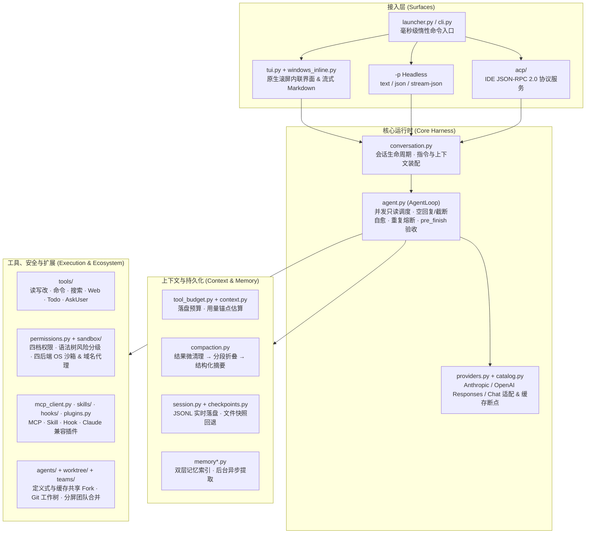

<p align="center">
  
</p>

<h1 align="center">MossCode</h1>

<p align="center">
  <b>面向长程软件工程任务的终端与 IDE 双栖 Coding Agent Harness</b><br />
  <sub>自愈式 Agent Loop · 四阶渐进上下文与跨协议 KV 缓存 · 四后端原生 OS 沙箱 · 多智能体工作树团队 · ACP 编辑器集成</sub>
</p>

<p align="center">
  <a href="https://github.com/yzd05/mosscode/actions/workflows/ci.yml"></a>
  
  
  
  <a href="LICENSE"></a>
</p>

<p align="center">
  <b>中文</b> · <a href="README.en.md">English</a> · <a href="docs/usage.md">使用指南</a> · <a href="docs/claude-code-patterns.md">对照 Claude Code 架构取舍</a> · <a href="docs/reference/evaluations.md">基准评测</a> · <a href="docs/reference/acp.md">IDE 接入 (ACP)</a> · <a href="ROADMAP.md">路线图</a> · <a href="CHANGELOG.md">更新日志</a>
</p>

---

**MossCode** 是用 Python 构建的工程级编码智能体运行时（Agent Harness），设计上深度参考 Claude Code 与 pi，并将同一套核心会话编排同时暴露为 **终端原生内联界面（TUI）**、**脚本化无界面模式（`-p`）** 与 **Agent Client Protocol（`moss acp`）编辑器服务**。不绑死单一模型厂商，权限与系统沙箱分层可控，专为需要数十轮工具迭代、跨会话记忆与多智能体协同的真实代码库任务打造。

### 核心工程特性

<table>
  <tr>
    <td width="50%" valign="top">
      <b>⚡ 自愈式 Agent Loop</b><br />
      相邻只读工具最高 4 路并发；空回复与思考触顶自动退避重发，正文截断自动无缝续写；连续重复调用自动提醒与熔断；支持 <code>/goal</code> 目标判断续跑与 <code>pre_finish</code> 确定性测试验收。
    </td>
    <td width="50%" valign="top">
      <b>🧠 四阶渐进上下文与 KV 缓存保护</b><br />
      大结果落盘预算 → 零模型请求的旧结果微清理 → 保历史与 <code>/rewind</code> 的增量分段折叠 → 9 段式结构化摘要 + <code>8,000</code> Token 用户原话保留；状态变更采用末尾追加提醒，严守跨协议前缀缓存命中。
    </td>
  </tr>
  <tr>
    <td width="50%" valign="top">
      <b>🛡️ 四档权限与四后端 OS 沙箱</b><br />
      支持 <code>default</code> / <code>acceptEdits</code> / <code>plan</code>（只读规划） / <code>bypassPermissions</code> 与三层规则；内置 Linux <code>bubblewrap+seccomp</code>、macOS <code>Seatbelt</code>、Windows <code>MXC</code> / 受限令牌沙箱，配合回环域名代理与子进程密钥剥离。
    </td>
    <td width="50%" valign="top">
      <b>🔌 三大协议统一与零重复配置</b><br />
      原生适配 <code>Anthropic Messages</code>、<code>OpenAI Responses</code>、<code>Chat Completions</code>（流式、提示缓存、思考强度、视觉输入、LiteLLM 离线价格目录）；支持一键 <code>follow</code> 本机已配好的 Claude Code 或 Codex。
    </td>
  </tr>
  <tr>
    <td width="50%" valign="top">
      <b>🧩 原生 IDE 集成（ACP 1.0）</b><br />
      <code>moss acp</code> 提供标准 stdio JSON-RPC 2.0 服务，直接接入 <b>JetBrains（PyCharm / IDEA）</b>、<b>Zed</b> 等编辑器：支持多目录并发会话隔离、结构化 Diff 预览、模式与模型联动及原生权限审批桥接。
    </td>
    <td width="50%" valign="top">
      <b>🤝 多智能体与分屏工作树团队</b><br />
      兼备定义式子 Agent、<b>共享父对话 KV 缓存的 <code>Agent Fork</code></b>、Git Worktree 物理隔离，以及在 <b>Windows Terminal / tmux</b> 分屏窗格中并行协作、按任务依赖拓扑安全合入的 Agent 团队。
    </td>
  </tr>
  <tr>
    <td width="50%" valign="top">
      <b>⏪ 消息级时光机与双层记忆</b><br />
      JSONL 实时落盘存档，<code>/rewind</code> 可将工作区文件与对话同时回退至任意历史消息之前；分层加载 <code>AGENTS.md</code> 指令，后台异步提取跨会话记忆笔记并通过增量失效提醒保持缓存前缀稳定。
    </td>
    <td width="50%" valign="top">
      <b>🔧 Claude Code 兼容扩展生态</b><br />
      完整支持 <code>MCP</code>（后台非阻塞连接与工具发现）、Agent <code>Skills</code>（<code>SKILL.md</code> 与专属脚本工具）、四类生命周期 <code>Hooks</code>，以及兼容 <code>.claude-plugin</code> 布局的用户级/项目级插件市场。
    </td>
  </tr>
</table>

### 公开基准实测（Terminal-Bench 2.1）

在锁定的 **Harbor 0.26.0 · Terminal-Bench 2.1** 首次 12 题开发基线（同一 `deepseek-flash` 端点、官方容器资源与时限、单并发、无人工干预）下，与 Harbor 内置基准智能体 **Terminus 2** 的同场实测对照：

| 评测对象 | 运行形态 | 端到端通过率（12 题） | 排除容器环境故障诊断口径 | 统一低谷价估算总开销 |
| :--- | :--- | :---: | :---: | :---: |
| **MossCode** | Harbor 锁定 wheel 适配器 | **9 / 12（75.0%）** | **9 / 10（90.0%）** | **~\$0.24**（下界） |
| **Terminus 2** | Harbor 0.26.0 内置 `2.0.0` | 7 / 12（58.3%） | 7 / 11（63.6%） | \$0.45 |

> [!NOTE]
> 以上为固定种子抽样的 12 题单次开发基线结果（非全量 89 题官方榜单）；3 条零模型费用环境故障（2 次容器 APT 502、1 次 `tmux` 启动异常）均如实保留在端到端分母中。完整的复现命令、价格快照、锁文件校验与边界说明见 [评估与版本对照](docs/reference/evaluations.md)。

## 安装

需要 **Python 3.12+**。推荐使用 [uv](https://docs.astral.sh/uv/) 安装为全局独立命令：

```bash
# 从 GitHub 主干直接安装最新版本（推荐，立即可用）
uv tool install git+https://github.com/yzd05/mosscode.git

# 或从 PyPI 安装发布版
uv tool install mosscode

# 自检安装、PATH、配置、沙箱后端与外部工具（零网络请求）
moss doctor
```

安装后同时提供 `moss` 与 `mosscode` 两个等价命令。升级、卸载、各平台依赖（如 `ripgrep`、沙箱后端）及容器内运行说明见 [安装细节](docs/usage.md#安装细节)；本地开发源码安装见 [参与贡献](CONTRIBUTING.md)。

## 配置

首次在终端运行 `moss` 会自动进入交互式配置向导（之后随时可执行 `moss setup`）：

| 配置方式 | 适用场景 | 体验 |
| :--- | :--- | :--- |
| **一键跟随（`follow`）** | 本机已配好 Claude Code 或 Codex（含 CC Switch / Magpie） | 零重复输入，直接复用其地址、模型与密钥，切换服务后 `/model` 即时同步 |
| **内置厂商预设（`preset`）** | DeepSeek、Kimi、GLM、通义千问、OpenRouter、Anthropic、OpenAI | 自动填充协议、API 地址、默认模型与环境变量名，只需选定模型与凭据 |
| **系统凭据管理器** | Windows 凭据管理器 / macOS 钥匙串 / Linux Secret Service | `moss key set <名称>` 加密存储密钥，`config.yaml` 中绝不落盘明文 |

若偏好手动编辑 `~/.mosscode/config.yaml`，最小可用配置仅需 5 行（完整字段说明见 [config.example.yaml](config.example.yaml)）：

```yaml
providers:
  - name: deepseek
    preset: deepseek                  # 或直接指定 protocol: anthropic-messages / openai-responses / openai-chat-completions
    model: deepseek-chat
    api_key_env: DEEPSEEK_API_KEY     # 环境变量名；或使用 api_key_keyring 引用系统凭据管理器条目
```

项目级配置信任机制、权限规则、MCP、Skill、Hook、子 Agent 与插件配置详见 [使用指南](docs/usage.md#配置)。

## 使用

### 命令行五种入口

```bash
moss                           # 启动终端原生内联交互界面（保留终端滚屏与鼠标选词）
moss "梳理本项目的核心模块职责"   # 启动交互界面并立即发送首条任务
moss -c                        # 恢复当前项目最近一次会话（或 moss --resume <会话ID>）
moss -p "运行测试并汇总失败原因"  # 无界面自动化模式（支持 text / json / stream-json 输出）
moss acp                       # 启动标准 ACP 协议服务（stdio JSON-RPC 2.0，供 IDE 接入）
```

<details>
<summary><b>✨ 在 PyCharm / IntelliJ IDEA / Zed 等编辑器中接入 MossCode（点击展开配置）</b></summary>

<br />

在 JetBrains AI Chat 的自定义 ACP Agent 配置（`~/.jetbrains/acp.json`）或 Zed 的 `settings.json` 中指向 `moss acp` 即可在 IDE 侧边栏直接驱动 MossCode（完整能力见 [ACP 编辑器集成](docs/reference/acp.md)）：

```json
{
  "agent_servers": {
    "MossCode": {
      "command": "moss",
      "args": ["acp"]
    }
  }
}
```

</details>

### 交互快捷指令速查

| 类别 | 常用命令与按键 | 作用 |
| :--- | :--- | :--- |
| **会话与时光机** | `/resume` · `/rewind`（或连按两次 `Esc`） · `/clear` | 恢复历史会话；将**工作区文件与对话**一键回退至某条消息前；开启新会话 |
| **规划与长任务** | `/plan <任务>` · `Shift+Tab` · `/goal <完成条件>` | 进入只读调查规划模式；循环切换四档权限；设定目标由独立裁判自动续跑至达成 |
| **上下文与状态** | `/compact [侧重点]` · `/status` · `/todo` · `/memory` | 按需定向压缩上下文；查看 Token、缓存命中率与费用估算；查看任务清单与记忆笔记 |
| **模型与安全** | `/model` · `/thinking` · `/permissions` · `/sandbox` | 无损历史切换提供商/模型与思考强度；查看或切换权限档位与系统命令沙箱 |
| **多智能体与扩展** | `/tasks` · `/team` · `/mcp` · `/skills` · `/plugins` | 管理后台命令与子 Agent、分屏团队、MCP 连接、Skill 规程与已安装插件 |
| **输入框增强** | `@路径#L10-20` · `!命令` / `!!命令` · `Alt+V` · `Ctrl+B` | 精确内联引用代码行；免模型直跑 Shell；粘贴剪贴板截图；将前台长命令切入后台 |

全部快捷键、权限规则语法与无界面 CI 集成见 [使用指南](docs/usage.md#按键与命令)。

## 架构

### 全景分层架构



### 四阶渐进上下文减压流水线（Cache-Preserving Compaction）

为了在超长工程任务中兼顾 **高缓存命中率（KV-Cache Prefix Invariance）** 与 **低信息折损**，MossCode 从不在每轮随意篡改历史中段，而是按以下四道防线依次降级：


<details>
<summary><b>各源码模块职责速查表（点击展开）</b></summary>

<br />

| 模块 | 职责 |
| :--- | :--- |
| `agent.py` | Agent Loop：请求循环、工具分批并发执行、排队消息、停止条件、计划模式、`pre_finish` 验收与压缩时机 |
| `context.py`、`compaction.py`、`tool_budget.py` | 以模型返回用量为锚点的增量上下文估算、四阶减压（微清理/分段折叠/摘要压缩）、大结果落盘与批量读取配额 |
| `session.py`、`serialization.py`、`checkpoints.py` | JSONL 会话实时存档、崩溃恢复与锁、文件级修改前快照与 `/rewind` 双重回退 |
| `memory.py`、`memory_extract.py`、`tools/memory.py` | 用户级/项目级记忆笔记存储与校验、防盲写覆盖的后台异步提取、`memory` 工具与缓存友好的失效提醒 |
| `providers.py`、`catalog.py` | Anthropic Messages、OpenAI Responses、Chat Completions 三协议适配，首事件前退避重试，离线模型窗口与价格目录 |
| `prompts.py` | 七段式稳定系统提示词、工具清单、`<environment>` 与追加式 `<system-reminder>`、`AGENTS.md` 层级合并 |
| `tools/` | 文件读写改、进程与后台命令、ripgrep/pathspec 双路径搜索、安全网页抓取与搜索、`todo_write`、`ask_user` |
| `permissions.py`、`security.py`、`sandbox/` | 四档权限与三层规则、`tree-sitter-bash` 子命令语法级风险识别、Bubblewrap / Seatbelt / MXC / 受限令牌沙箱与域名代理 |
| `mcp_client.py`、`skills/`、`hooks/`、`plugins.py` | 后台非阻塞 MCP 连接、Agent Skills 扫描与脚本工具、四类生命周期 Hook、兼容 Claude Code 格式的插件管理 |
| `agents/`、`worktree/`、`teams/`、`coordinator.py` | 定义式与前缀共享 `Fork` 子 Agent、Git 工作树隔离与清理、分屏多智能体团队（邮箱/看板/拓扑合并） |
| `tui.py`、`windows_inline.py`、`scrollback.py` | 原生滚屏内联 TUI、Windows 控制台驱动、分块定格流式 Markdown、深浅终端自适应配色 |
| `acp/` | Agent Client Protocol 1.0 服务端，多工作区隔离会话、`session/load` 重放、Slash 命令与权限桥接 |
| `launcher.py`、`cli.py`、`setup.py`、`doctor.py` | 零 SDK 导入的极速 CLI 启动器、参数路由、交互式引导与跨平台环境诊断 |

</details>

### 文档导航

| 主题 | 文档入口 |
| :--- | :--- |
| **快速上手与日常使用** | [使用指南](docs/usage.md) · [命令行参数](docs/reference/cli.md) · [终端界面](docs/reference/interface.md) · [交互命令](docs/reference/commands.md) · [ACP 编辑器集成](docs/reference/acp.md) |
| **架构设计与对比** | [**对照 Claude Code 的 18 项架构取舍**](docs/claude-code-patterns.md) · [系统提示与缓存](docs/reference/prompts.md) · [上下文管理](docs/reference/context.md) · [路线图](ROADMAP.md) |
| **安全、权限与沙箱** | [权限档位与规则](docs/reference/permissions.md) · [原生命令沙箱](docs/reference/sandbox.md) · [在容器中运行](docs/reference/container.md) · [安全策略](SECURITY.md) |
| **多智能体、扩展与评测** | [工具与循环](docs/reference/tools.md) · [模型提供商](docs/reference/providers.md) · [会话存档](docs/reference/sessions.md) · [记忆笔记](docs/reference/memory.md) · [MCP](docs/reference/mcp.md) · [Skill](docs/reference/skills.md) · [Hook](docs/reference/hooks.md) · [插件](docs/reference/plugins.md) · [子 Agent](docs/reference/subagents.md) · [Git 工作树](docs/reference/worktree.md) · [Agent 团队](docs/reference/teams.md) · [评估与版本对照](docs/reference/evaluations.md) |

### 参与开发

```bash
uv venv --python 3.12
uv pip install -e ".[dev]"
python -m pytest -q
ruff check && ruff format --check
```

详见 [参与贡献](CONTRIBUTING.md) 与 [开发说明](AGENTS.md)。MossCode 以 [MIT 许可证](LICENSE) 开源发布。
