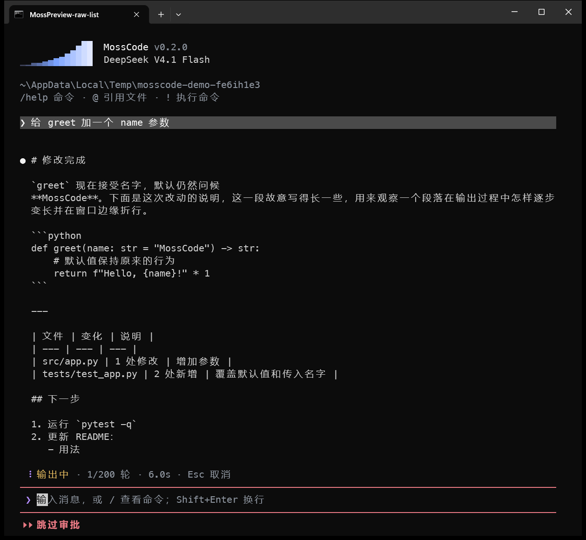
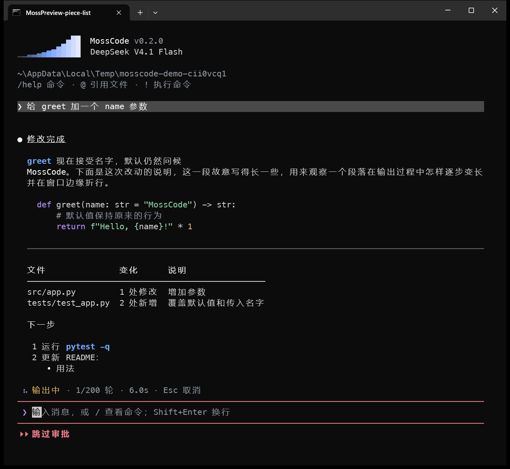

# 流式渲染 Markdown

日期：2026-11-12。状态：**已确认**。用户的决定（2026-11-12）：全部按建议——Q1 中断时保持 Markdown 显示，Q2 一起改掉多出的空行，Q3 有序列表序号改成“1.”，Q4 这次不做。

来源：界面外观打磨完成后，用户从推荐的下一步中选了“流式渲染 Markdown”：回复输出的过程中就按 Markdown 显示，而不是先显示原文、结束后才渲染。

## 现状

回复正文逐块到达时，实时区域显示的是 Markdown 源码（`#`、`**`、`` ``` ``、`| --- |` 原样可见）；整段收到后才换成 Markdown 控件渲染，紧接着写入终端滚动历史，滚动历史由 Rich 再渲染一次。

| 改动前（输出中） | 改动后（输出中） |
| --- | --- |
|  |  |

两张都是在 Windows Terminal 中实拍的原型（100 列），停在同一个位置。改动后输出中的表格见 [另一张实拍](previews/after-streaming-table.png)，输出结束后的样子见 [完成后](previews/after-complete.png)。

成熟产品（Claude Code、Codex CLI、Gemini CLI）都在输出过程中渲染 Markdown。

## 原型中查明的事

在 `.test-artifacts/` 中做了两种原型，用模拟模型以每秒 100 个片段（每片 4 个字符，接近快速模型的输出速度）输出一段 2676 字的回复，测事件循环最长被占用多久（即这段时间里按键得不到响应）。

| 做法 | 输出中最长卡顿 | 超过 100 ms 的次数 | 与滚动历史是否一致 |
| --- | --- | --- | --- |
| 改动前（纯文本） | 52 ms | 0 | 结束时整段换样 |
| A. Textual 自带的流式 Markdown 控件（`MarkdownStream`） | 128 ms（Windows Terminal 中 317 ms）；单次更新最长 2.2 s | 1 | 不一致，见下 |
| B. 每次用 Rich 重新渲染整段 | 57 ms；8920 字时 137 ms | 0；8920 字时 34 次 | 逐行一致 |
| **C. 逐块渲染：已结束的块缓存，只重画最后一块** | **35 ms**（Windows Terminal 中 44 ms）；8920 字时 52 ms | **0** | **逐行一致** |

A 被否定，原因有两个：

- 慢。每来一段文字都要拆掉并重新挂载最后一个块的控件；块一多，一次更新要几百毫秒到两秒，期间按键没有反应。
- 和滚动历史画得不一样，回复结束写入滚动历史时会整段跳变：分隔线不可见；表格带整圈边框、撑满整行（[实拍](previews/rejected-textual-widget.png)），滚动历史中是无边框、按内容宽；有序列表是“1.”，滚动历史中是“1”；窄窗口下代码长行被截断，滚动历史中折行。80 列时实时 31 行、滚动历史 28 行。

C 用的就是写入滚动历史的那套 Rich 渲染（同样的标题、代码着色、分隔线、表格），所以输出中、输出结束、写入滚动历史三个时刻画出来的行完全相同；它的开销与改动前的纯文本相当。逐块渲染与整段一次渲染的结果，用三份语料（含嵌套列表、列表中的代码块、引用中的列表、Setext 标题、缩进代码、HTML 块、中文长段落）在 30、46、80 列下逐字输入、每个前缀都比对过，只有一处不同：引用式链接的定义写在后面时，前面的 `[ref]` 在定义到达之前显示为原文。回复结束时整段重新渲染一次，这一处也就一致了。

## 改动

### R1 输出中渲染 Markdown

- 正文片段到达时，实时区域按 Markdown 显示，渲染方式与写入滚动历史的完全相同（同一个 Rich 渲染器、同一套颜色和排版）。
- 实现用方案 C：把正文按顶层块切开，已经结束的块（后面已经开始了新块）只渲染一次并按宽度缓存，每次只重新渲染最后一块。块的边界只在整行到达后才确定，因为半行文字可能改变上一块的含义（例如 `2` 在变成 `2.` 之前是段落，之后是上面列表的第 3 项）。
- 回复结束时用完整文本再渲染一次，然后照旧写入滚动历史。
- 实时区域不再使用 Textual 的 Markdown 控件；`DialogueMarkdown`、`DialogueCode` 和 `.answer Markdown…` 的样式随之删除。渲染主题（目前写在 `render_transcript` 里）提成 `scrollback.py` 中的共用常量，实时区域和滚动历史共用。

### R2 未写完的语法

按 Markdown 解析器对“当前已到达的文字”的理解显示，不猜测后文：

| 情况 | 输出中显示 |
| --- | --- |
| 未闭合的 `**粗体` 、`` `代码 `` | 显示原文符号，闭合的那一刻变成粗体 / 行内代码 |
| 未闭合的代码块 | 已到达的部分按代码块显示并着色 |
| 表格只到表头行 | 先是一行普通文字，分隔行 `\| --- \|` 到达后变成表格（这一行会跳变一次） |
| 表格后续行更长 | 列宽随内容变宽 |
| `[文档](https://…` 未闭合 | 原文，闭合后变成链接文字 |

这些都是解析器的自然结果，不额外处理。

### R3 各种结束方式

| 情况 | 行为 |
| --- | --- |
| 先思考后正文 | 不变：正文开始时思考收成“✻ 思考 Ns”，正文按 R1 显示 |
| 正常结束、到达输出上限被截断 | 用完整文本重新渲染一次，再写入滚动历史 |
| 只调用工具、调用工具前有一段文字 | 与正常结束相同 |
| 服务重试（`ReplyRetry`）丢弃已输出内容 | 清空缓存，回到“等待回复…” |
| 自动续写（`AutoContinue`） | 新的一条回复，各自独立渲染 |
| 用户取消、出错中断 | 已输出的部分保持 Markdown 显示，下面空一行接中断说明（见 Q1）；写入滚动历史的内容与之相同 |

### R4 性能

- 已结束的块不再重新渲染；窗口宽度变化时按新宽度重新渲染一次。
- 只有一个很大的未结束块时，重画的开销随块的大小增长：实测一个未结束的 400 行代码块渲染一次约 75 ms，3000 字的段落约 3 ms。为此对最后一块的重画限速：上一次重画用了 t 毫秒，下一次至少间隔 3t（最多 250 ms）。常见回复不触发限速；超长代码块输出时画面更新稍慢，但按键不卡。
- 验收标准：上面的 2676 字和 8920 字两种测法下，输出中事件循环最长卡顿不超过改动前纯文本的 1.5 倍，没有超过 100 ms 的卡顿。

### R5 输出结束时不跳变

- 回复从实时区域移到滚动历史时，每一行的内容和位置都不变。用测试保证：同一段示例回复在若干宽度下，实时区域画出的行与 `render_transcript` 的行逐行相等。
- 原型中还发现一处已有的不一致：输出中“●”上方比写入滚动历史后多一个空行（[改动后](previews/after-streaming.png)与[完成后](previews/after-complete.png)对比可见），回复结束时整段上移一行。建议这次一起改掉（Q2）。

## 不做

- **长回复边输出边写入滚动历史**（Codex CLI 的做法）：超过一屏的回复仍像现在一样在实时区域内滚动，结束后整段写入滚动历史。逐块写入要改动内联模式下光标位置的记账，风险与本项不在一个量级，建议另做（Q4）。
- `--prompt` 模式仍输出纯文本。
- 思考内容仍显示纯文本。

## 需要你决定的

| # | 问题 | 建议 |
| --- | --- | --- |
| Q1 | 取消或出错中断时，已输出的部分怎么显示？现在是 Markdown 源码加中断说明 | **保持 Markdown 显示**，与输出中一致；滚动历史中同样 |
| Q2 | 输出中“●”上方多出的一个空行要不要一起改掉 | **一起改**，否则每条回复结束时都会整体上移一行 |
| Q3 | 有序列表的序号：现在滚动历史中画成“1 运行”，没有点 | **改成“1. 运行”**，与源码和常见习惯一致；实时区域和滚动历史同时生效 |
| Q4 | 长回复边输出边写入滚动历史 | **这次不做**，另立一项 |

## 影响的代码、测试与文档

- `src/mosscode/scrollback.py`：共用的 Markdown 主题；逐块渲染的类（缓存已结束的块、限速重画最后一块）；Q3 的有序列表序号。
- `src/mosscode/tui.py`：`ChatEntry` 的 `append`、`discard`、`finish`、`seal_tool_request`、`interrupted`、`transcript` 改用 R1 的渲染；删除 `DialogueMarkdown`、`DialogueCode` 和相关 CSS；Q2 的空行。
- 测试：`tests/test_tui.py` 中“Markdown 等到结束才渲染”的测试改为断言输出中已经渲染；新增逐块渲染与整段渲染逐前缀一致、实时区域与滚动历史逐行一致、未闭合语法、重试清空、取消后的显示、重画限速的测试；`tests/test_agent_tui.py`、`tests/test_tool_tui.py`、`scripts/verify_inline_terminal.py` 中按 `.raw` / `.answer` 两个控件断言的地方随控件调整。
- 文档：[interface.md](../../reference/interface.md) 中“正文逐块显示纯文本，完整收到后一次渲染 Markdown”和“最终答复逐块输出，结束后渲染 Markdown”两处；`CHANGELOG.md` 的 `[Unreleased]`。

## 验收

在 Windows Terminal 中（100 列和 46 列）：

1. 输出中标题、粗体、行内代码、代码块着色、分隔线、表格、嵌套列表、引用都已渲染，停在代码块、表格、列表中间时截图检查；
2. 输出结束写入滚动历史前后截图逐行对比，没有跳变；
3. 输出过程中连续输入文字，输入框没有可感知的延迟（按 R4 的标准测量）；
4. 取消、重试、调用工具、思考后输出四种情况各走一遍；
5. 输出中改变窗口宽度，重排正确；
6. `scripts/verify_inline_terminal.py` 通过。

## 实现记录

2026-11-12 实现，按 Q1–Q4 的建议。

- `scrollback.py`：新增 `StreamingMarkdown`（按块缓存、只重排最后一块、结束时整段再排一次）、共用的 `MARKDOWN_THEME`、带点的有序列表序号（`TranscriptListItem`）。
- `tui.py`：回复正文改为一个 `Static` 显示 `StreamingMarkdown`；重画间隔取 `min(0.25 s, 3 × 上次重排最后一块的耗时)`；取消或出错时显示“Markdown、空行、说明”，实时区域和滚动历史相同；删除 `DialogueMarkdown`、`DialogueCode` 及其 CSS。多出的空行（Q2）的原因是 `Screen` 的上边距：滚动历史每块末尾已经有一个空行。改为启动区自带上下边距，`#chat` 至少一行，空闲时输入框上方的间距不变。
- 测试：逐前缀对比（30 列逐字、80 列每 7 字）、实时区域与滚动历史逐行一致、未闭合语法、有序列表、取消后的显示（实时区域与滚动历史）、重试后清空、重画限速、Q2 的空行；原有按 `.raw` / `.answer` 两个控件断言的测试改为断言显示出来的行。相关测试文件全部通过，`ruff check`、`ruff format --check` 通过。

验收结果（Windows Terminal）：

1. 100 列停在代码块、表格、列表中间，46 列停在表格中间，都已渲染（[列表中间](previews/implemented-streaming-list.png)）；
2. 列表中间与完成后的截图中，已显示的各行位置和内容相同，没有跳变；表格在写完之前会随新的单元格调整列宽，写完后不再变化；
3. 8920 字、每秒 100 段时事件循环最长阻塞 51 ms（纯文本对照 55 ms），没有超过 100 ms 的；
4. 取消（[截图](previews/implemented-cancelled.png)）、调用工具、思考后输出在真实终端中走过；重试由无界面测试覆盖，没有在真实终端中复现；
5. 输出中把窗口从 104 列缩到约 46 列再放大，重排正确；
6. `scripts/verify_inline_terminal.py` 在 Windows Terminal 中通过。
